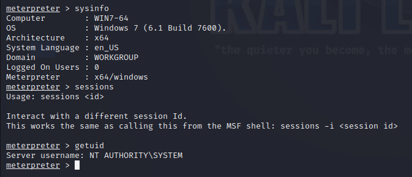

# TechShield Cybersecurity Assessment and Penetration Testing

**Network vulnerability assessment, web application testing, exploitation validation, and digital forensics in an authorized lab.**

As part of my completed cybersecurity capstone, I assessed a virtual lab from a Kali workstation, mapped its exposed services, investigated Windows SMB weaknesses and tested DVWA at its deliberately vulnerable security level. I also examined an NTFS training image for concealed JPEG content.

The strongest evidence shows an MS17-010 detection followed by Windows SYSTEM access, server-side command execution through DVWA uploads, and recovery of concealed files. The portfolio explains the evidence and its limits alongside practical remediation.

## Explore the project

| Section | Contents |
|---|---|
| [Assessment](docs/assessment.md) | Objectives, scope, topology, inventory, methodology and tools |
| [Vulnerability findings](findings/README.md) | Prioritized findings in the eight-part assessment format |
| [Additional milestones](docs/milestones.md) | Web testing, exploitation and forensic work |
| [Evidence gallery](evidence/README.md) | Captions and supporting screenshots |
| [Evidence limitations](docs/evidence-review.md) | Authentication, scoring and source discrepancies |
| [Remediation and lessons](docs/remediation.md) | Risk priorities, retesting and conclusions |
| [References](docs/references.md) | Technical documentation |

## Assessment highlights

| Workstream | Evidence-supported outcome |
|---|---|
| Discovery | Six responding addresses in 192.168.57.0/24 |
| Windows assessment | SMB exposure, positive MS17-010 NSE result and SYSTEM session |
| Greenbone | Findings visible in report screenshots; successful target authentication unverified |
| DVWA | Database enumeration, XSS alert and uploaded PHP command execution |
| Forensics | Image checksum, recovered-file listing and archive extraction |

*Meterpreter system information and privilege output from the Windows lab target.*

## Evidence and authorization

All activity documented here took place in a temporary, authorized cybersecurity training sandbox that has since been destroyed. The source screenshots record November 2025 activity. This repository was prepared from existing reports, without rerunning assessments. Original academic documents are retained separately in the private source collection.

Raw Nmap/Greenbone exports were absent from the supplied folder. Findings therefore distinguish screenshot-supported outcomes, scanner-reported issues and unresolved claims. Credential configuration alone does not establish an authenticated scan. See the evidence review before interpreting severity totals or coverage.

## Skills demonstrated

Network discovery · service enumeration · vulnerability triage · exploitation validation · web application testing · evidence handling · NTFS analysis · technical reporting
