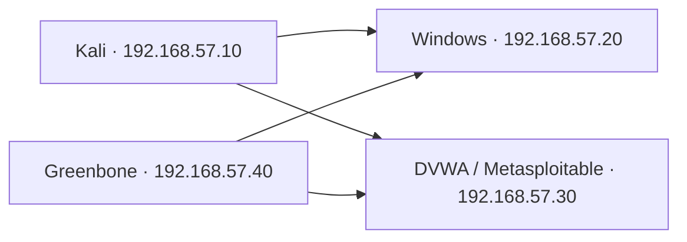

# Assessment overview

## Objectives and authorization

Assess the supplied TechShield training targets, demonstrate security weaknesses where evidence supports successful validation, and translate the results into remediation priorities. The supplied capstone statement identifies the Kali pentester, victim laptop and application server. Public reporting excludes instructional documents and access credentials.

## Network architecture



This diagram represents assessment relationships within 192.168.57.0/24. Routing, firewall rules and isolation enforcement were not independently verified.

| Address | Role and evidence | Scope |
|---|---|---|
| .10 | Kali assessment workstation | Tooling |
| .20 | WIN7-64, Windows 7 build 7600 x64 in session output | Windows target |
| .30 | Metasploitable Linux, DVWA | Application target |
| .40 | Greenbone scanner, HTTP/HTTPS | Tooling |
| .250 | Responding auxiliary address, role unverified | Discovery only |
| .254 | Responding address, gateway role suggested by narrative | Discovery only |

## Discovery and enumeration

The following commands are recorded in the supplied reports or screenshots. They document historical lab activity.

```sh
ip a
sudo netdiscover -i eth0 -r 192.168.57.0/24
sudo nmap -sn 192.168.57.0/24
sudo nmap -sS -T4 192.168.57.20
sudo nmap -sV -sC -O 192.168.57.10,20,30,40
nmap -p445 --script smb-vuln-ms17-010 192.168.57.20
```

Netdiscover with an explicit range performs active discovery unless passive mode is selected. The original narrative calls it passive, which is not supported by the recorded command. Nmap host discovery reports six hosts. Discovery establishes reachability, while service enumeration identifies the interfaces that warrant further testing.

| Host | Selected TCP services observed |
|---|---|
| .20 | 135 RPC, 139 NetBIOS, 445 SMB |
| .30 | 21 FTP, 22 SSH, 23 Telnet, 25 SMTP, 53 DNS, 80 HTTP, 139/445 SMB, 1099 RMI, 1524 bindshell-labelled service, 3306 MySQL, 5432 PostgreSQL, 5900 VNC, 6667 IRC, 8009 AJP, 8180 HTTP |
| .40 | 80 HTTP, 443 HTTPS |
| .10 | All 1,000 TCP ports in the displayed default scan closed |

Port labels alone do not verify exploitation or software vulnerability. The Linux version scan supports legacy software observations. No full 65,535-port or UDP coverage is claimed.

[Discovery and enumeration screenshots](../evidence/README.md)

## Greenbone assessment

Reports record the Full and fast profile and All IANA-assigned TCP port list. Credential objects and target assignments are visible in the private source images. A Windows findings screenshot supports the five scanner observations in the findings register.

Successful SMB authentication is unverified. No raw report, authentication-success check or local-check coverage record was available. A completed task or configured credential does not establish successful authenticated checks. Windows and Linux scan totals cannot be reconstructed reliably from the selected screenshots.

## Tools

Kali Linux hosted Netdiscover, Nmap, Metasploit, Hydra and John the Ripper. Greenbone/OpenVAS supplied vulnerability assessment results. DVWA supplied intentionally vulnerable web modules. Autopsy and Linux checksum/archive utilities supported the forensic milestone. Tool roles are documented from the supplied evidence, and versions are claimed only where displayed.
