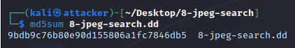
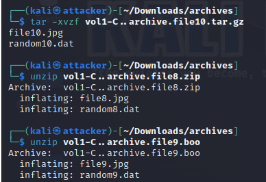

# Completed milestones and evidence boundaries

| Milestone | Supported work | Remaining limitation |
|---|---|---|
| 1 | Discovery, enumeration, Greenbone findings | Authentication success and full scan coverage unverified |
| 2 | DVWA SQL enumeration, XSS alert, PHP execution and Linux session | XSS persistence partly narrative; no root escalation evidence |
| 3 | MS17-010 validation, SYSTEM session, credential testing | Secrets withheld; no cross-host movement demonstrated |
| 4 | NTFS image analysis, checksum, concealed-file recovery and archive extraction | Original disk image and recovered binaries absent |

## Forensic examination

The supplied milestone report records Autopsy analysis of 8-jpeg-search.dd. The terminal checksum image shows MD5 9bdb9c76b80e90d155806a1fc7846db5. The underlying disk image was absent, so this portfolio cannot independently recompute that checksum.

The report identifies file1.jpg, file2.dat, file6.jpg, file7.hmm and file13.dll:here. These represent ordinary allocation, misleading extensions, paths described as deleted and an NTFS alternate data stream. Directory names alone do not establish deletion status. The recovered-file screenshot and Autopsy images support the examination workflow. Archive extraction screenshots also show JPEG members recovered from tar and ZIP containers, including a misleading .boo extension.

*Historical checksum calculation for the training image.*

*Archive members extracted during the forensic exercise.*

The report contains both completed archive screenshots and an earlier conditional screenshot placeholder. The extraction screenshot supports completed archive inspection, while a complete chain of custody and per-file recovery hashes remain unavailable.
