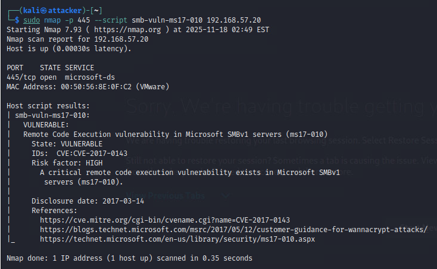

# MS17-010 SMB remote code execution

## 1. Vulnerability title

MS17-010 SMB remote code execution

## 2. Severity and CVSS score

High; scanner-reported 8.1. Source reports also claim 10.0 and 8.8, which are not adopted as a unified score.

## 3. Affected host and service

192.168.57.20, TCP 445

## 4. Synopsis

Nmap identifies MS17-010 exposure and exploitation screenshots show a Windows SYSTEM session.

## 5. Technical analysis

The NSE output reports VULNERABLE and CVE-2017-0143. Metasploit output and getuid support successful privileged execution. This establishes a lab compromise but does not independently map every CVE covered by MS17-010.

## 6. Evidence and screenshots

The screenshot supports the visible result. For credential findings it provides privilege context only, with credential evidence retained privately. [Evidence limitations](../docs/evidence-review.md).

## 7. Potential security impact

Remote control at SYSTEM privilege can expose files, permit credential access and disrupt the host.

## 8. Remediation recommendations

Apply the applicable Microsoft fixes, disable SMBv1, restrict SMB reachability and migrate the legacy host. Retest the NSE check and confirm patch state with authenticated inventory.

[Technical references](../docs/references.md) · [Finding register](README.md)
