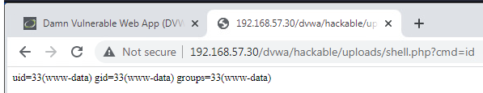

# Executable file upload in DVWA

## 1. Vulnerability title

Executable file upload in DVWA

## 2. Severity and CVSS score

Critical qualitative lab risk; numerical CVSS unassigned.

## 3. Affected host and service

192.168.57.30, DVWA over HTTP

## 4. Synopsis

An uploaded PHP file executed commands under the web service identity.

## 5. Technical analysis

Browser evidence shows whoami and id output from the uploads path. The displayed identity is www-data. A Linux Meterpreter session is also recorded. Root escalation is not established.

## 6. Evidence and screenshots

The screenshot supports the visible result. For credential findings it provides privilege context only, with credential evidence retained privately. [Evidence limitations](../docs/evidence-review.md).

## 7. Potential security impact

An attacker with access to the vulnerable upload module could read or modify data available to the web service and execute server-side commands.

## 8. Remediation recommendations

Store uploads outside the web root, deny script execution, validate allowed content server-side, randomize storage names and apply least privilege. Retest that executable uploads cannot run.

[Technical references](../docs/references.md) · [Finding register](README.md)
