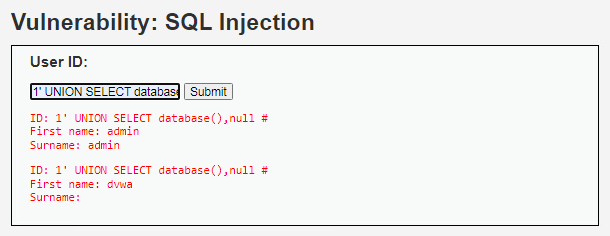

# SQL injection in DVWA

## 1. Vulnerability title

SQL injection in DVWA

## 2. Severity and CVSS score

High qualitative lab risk; numerical CVSS unassigned.

## 3. Affected host and service

192.168.57.30, DVWA SQL Injection module

## 4. Synopsis

Injected queries returned database information.

## 5. Technical analysis

Screenshots show UNION-based database and schema enumeration. Private evidence also contains credential-derived data and is excluded. A syntax error alone would be insufficient evidence, but query-derived output supports injection.

## 6. Evidence and screenshots

The screenshot supports the visible result. For credential findings it provides privilege context only, with credential evidence retained privately. [Evidence limitations](../docs/evidence-review.md).

## 7. Potential security impact

Unauthorized database reads can expose application records and credential material. Broader write access was not demonstrated.

## 8. Remediation recommendations

Use parameterized queries, restrict the database account, suppress detailed database errors and retest the original input paths.

[Technical references](../docs/references.md) · [Finding register](README.md)
