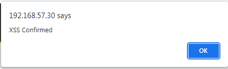

# Stored XSS in DVWA

## 1. Vulnerability title

Stored XSS in DVWA

## 2. Severity and CVSS score

High source qualitative rating; numerical CVSS unassigned.

## 3. Affected host and service

192.168.57.30, DVWA guestbook module

## 4. Synopsis

The report records stored JavaScript execution and an alert screenshot.

## 5. Technical analysis

An alert proves JavaScript execution. The report describes storage and reload behavior, but the static alert alone cannot prove persistence. Cookie-bearing screenshots are withheld. Account takeover was not demonstrated.

## 6. Evidence and screenshots

The screenshot supports the visible result. For credential findings it provides privilege context only, with credential evidence retained privately. [Evidence limitations](../docs/evidence-review.md).

## 7. Potential security impact

Code in the application origin can affect a visiting user and access browser-readable application data.

## 8. Remediation recommendations

Encode output for its context, sanitize permitted rich text, deploy an appropriate CSP and protect session cookies. Retest after reload with a separate lab session.

[Technical references](../docs/references.md) · [Finding register](README.md)
