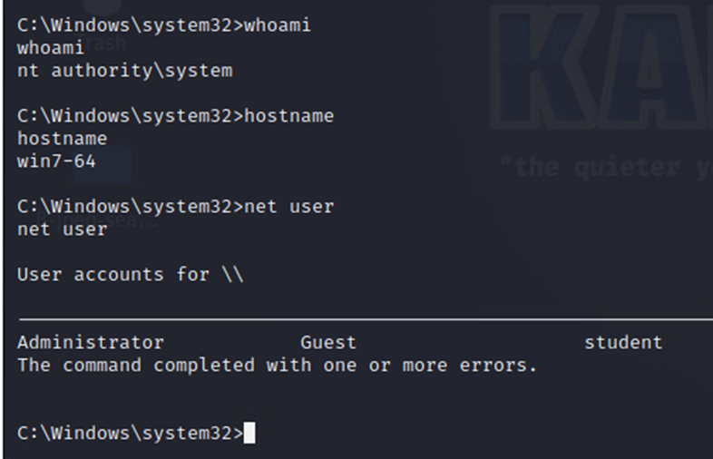

# Weak local credentials and password reuse

## 1. Vulnerability title

Weak local credentials and password reuse

## 2. Severity and CVSS score

Source-derived CVSS v3.1 9.8 for online guessing; 6.7 for privileged offline extraction. These contextual ratings are retained as source assessments.

## 3. Affected host and service

192.168.57.20, local accounts and SMB

## 4. Synopsis

Private screenshots show Hydra authentication success and John recovery of NTLM-derived credentials.

## 5. Technical analysis

Credential values, hashes and wordlists are excluded. The narrative disagrees about exact recovered values, so the portfolio makes no claim about their spelling. Offline recovery followed privileged access.

## 6. Evidence and screenshots

The screenshot supports the visible result. For credential findings it provides privilege context only, with credential evidence retained privately. [Evidence limitations](../docs/evidence-review.md).

## 7. Potential security impact

Guessable privileged credentials enable unauthorized access. Reuse can expand exposure after one account is compromised. Cross-host reuse was not established.

## 8. Remediation recommendations

Rotate credentials, use unique managed local administrator passwords, restrict administrative access, monitor failed logons and apply suitable throttling or lockout. Retest with authorized non-sensitive test accounts.

[Technical references](../docs/references.md) · [Finding register](README.md)
