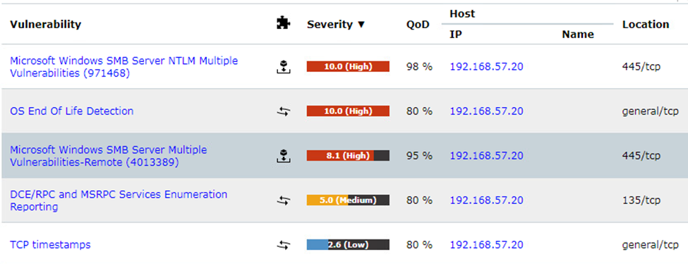

# Windows SMB Server NTLM multiple vulnerabilities KB971468

## 1. Vulnerability title

Windows SMB Server NTLM multiple vulnerabilities KB971468

## 2. Severity and CVSS score

Scanner-reported 10.0; Critical under CVSS v3-style bands; source version/vector unavailable.

## 3. Affected host and service

192.168.57.20, TCP 445

## 4. Synopsis

Greenbone lists this SMB finding.

## 5. Technical analysis

The summary row supports scanner detection only. Detailed plugin output and authentication success are unavailable. The original report attributes relay behavior without enough plugin detail to substantiate that mechanism.

## 6. Evidence and screenshots

The screenshot supports the visible result. For credential findings it provides privilege context only, with credential evidence retained privately. [Evidence limitations](../docs/evidence-review.md).

## 7. Potential security impact

An unresolved legacy SMB security defect can expose a central authentication and file-sharing boundary. Exact exploitability requires further validation.

## 8. Remediation recommendations

Verify applicable Microsoft bulletin and installed updates through authenticated checks, apply missing fixes and restrict SMB exposure.

[Technical references](../docs/references.md) · [Finding register](README.md)
