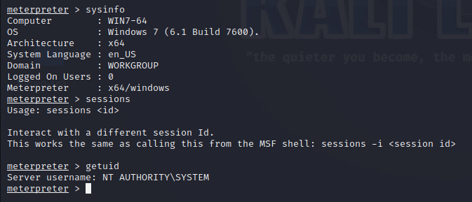

# End-of-life operating system

## 1. Vulnerability title

End-of-life operating system

## 2. Severity and CVSS score

Scanner-reported 10.0; Critical under CVSS v3-style bands; source version/vector unavailable.

## 3. Affected host and service

192.168.57.20, operating system

## 4. Synopsis

Greenbone reports OS end of life, and session output identifies Windows 7.

## 5. Technical analysis

The version is corroborated by system information. The scanner score is a product assessment, not a newly calculated CVSS vector. Support contract and patch entitlement were not established.

## 6. Evidence and screenshots

The screenshot supports the visible result. For credential findings it provides privilege context only, with credential evidence retained privately. [Evidence limitations](../docs/evidence-review.md).

## 7. Potential security impact

Legacy platform maintenance limits increase exposure to unresolved defects and complicate secure operation.

## 8. Remediation recommendations

Migrate to a supported platform, isolate the host during transition and validate application compatibility and update coverage.

[Technical references](../docs/references.md) · [Finding register](README.md)
