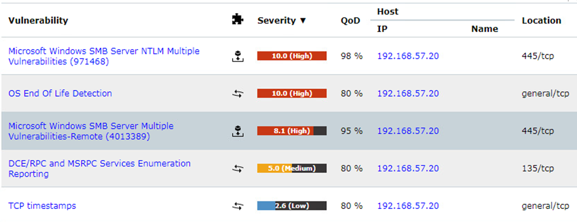

# DCE/RPC and MSRPC enumeration

## 1. Vulnerability title

DCE/RPC and MSRPC enumeration

## 2. Severity and CVSS score

Scanner-reported 5.0 Medium; version/vector unavailable.

## 3. Affected host and service

192.168.57.20, TCP 135

## 4. Synopsis

Greenbone reports remotely enumerable RPC services.

## 5. Technical analysis

The summary supports information exposure. It does not demonstrate code execution through RPC.

## 6. Evidence and screenshots

The screenshot supports the visible result. For credential findings it provides privilege context only, with credential evidence retained privately. [Evidence limitations](../docs/evidence-review.md).

## 7. Potential security impact

Interface information may assist follow-on reconnaissance.

## 8. Remediation recommendations

Restrict RPC to required management paths and retest enumeration from unauthorized segments.

[Technical references](../docs/references.md) · [Finding register](README.md)
