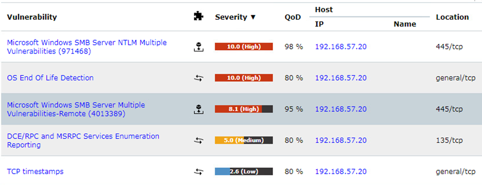

# TCP timestamps enabled

## 1. Vulnerability title

TCP timestamps enabled

## 2. Severity and CVSS score

Scanner-reported 2.6 Low; version/vector unavailable.

## 3. Affected host and service

192.168.57.20, TCP stack

## 4. Synopsis

Greenbone reports TCP timestamp behavior.

## 5. Technical analysis

The report summary supports this low-priority observation. No uptime calculation or exploitation is established.

## 6. Evidence and screenshots

The screenshot supports the visible result. For credential findings it provides privilege context only, with credential evidence retained privately. [Evidence limitations](../docs/evidence-review.md).

## 7. Potential security impact

Timestamp behavior may assist fingerprinting. Practical risk depends on implementation and exposure.

## 8. Remediation recommendations

Evaluate timestamp hardening against platform guidance and performance requirements after addressing exploitable weaknesses.

[Technical references](../docs/references.md) · [Finding register](README.md)
